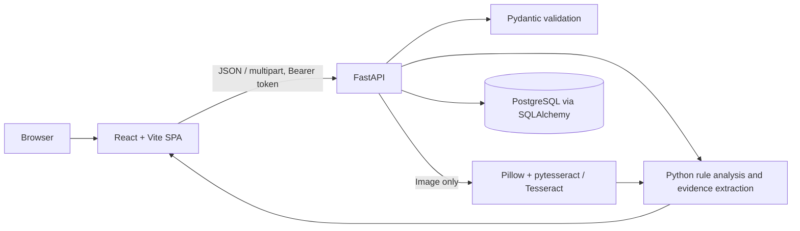

# CyberShield / VerifyPay — Complete Project Handoff

This consolidated handoff combines the ten project knowledge documents into one file. Read the master context first, then use the sections below as reference. The repository source and existing working changes are separate and must be preserved.

## 1. Master project context

# CyberShield VerifyPay — Master Project Context

**Snapshot prepared:** 2026-11-24 (Asia/Calcutta)
**Repository:** `C:\Users\Mdreh\Documents\Codex\2026-10-12 verify\CyberShield`
**Branch / revision:** `main` / `4b9ff9c` (`updated one .....!!!`), tracking `origin/main`
**Purpose:** transfer the repository facts and current development state to a new AI/account.

## 1. Purpose and boundaries

CyberShield VerifyPay is an educational payment-message review prototype. A signed-in user can submit text, a URL, or an image and receive preliminary rule-based warnings, selected extracted evidence, and a suggested next step. Its intended users are people learning to recognize suspicious payment requests, especially in Indian payment contexts, and project demonstrators using fictional data.

It does **not** verify payments, settlement, bank records, UPI ownership, recipients, or live website reputation. A screenshot saying “Payment Successful” is only text detected in the screenshot. A UPI ID is only text found in the submission. A trusted-payee result is a local text match, not account-owner verification. Scores are deterministic heuristic signals, never probabilities or fraud verdicts. Do not use real payment data, passwords, OTPs, or sensitive personal data in demonstrations.

The desired product direction is focused payment safety and fraud-risk awareness. Optional AI-assisted explanations were discussed as a possible future addition, but there is no AI model/API integration in the inspected source. Do not expand this into general finance, lending, EMI, or money-management software.

## 2. Current architecture at a glance



The frontend is a single large conditional-rendered React application in `frontend/src/App.jsx`; it does not use React Router. FastAPI routes, security helpers, OAuth, and account operations are concentrated in `backend/app/main.py`. Database access is in `backend/app/database.py`, models in `backend/app/models.py`, schemas in `backend/app/schemas.py`, risk/evidence logic in `backend/app/risk.py`, and OCR in `backend/app/ocr.py`.

## 3. Verified feature inventory (summary)

| Feature | Current status | What the source actually provides |
|---|---|---|
| Email/password accounts | Implemented; integration not fully revalidated | scrypt password hashes, email verification, bearer sessions, reset/change password, logout. |
| Google sign-in | Implemented conditionally; external flow not tested in this snapshot | Authlib OIDC authorization-code flow, signed state/session, PKCE configuration, one-time handoff code. Requires provider setup and reachable Google endpoints. |
| Microsoft sign-in | Not available in the UI; backend provider branch exists | UI marks it coming soon. Backend code expects a specific tenant and credentials. Project direction defers it. |
| TOTP MFA | Backend/UI code exists; end-to-end status unverified and intentionally deferred by prior user direction | Setup, enable, challenge, disable, encrypted secret and recovery-code handling. Do not prioritize until the user explicitly requests MFA. |
| Text checks | Implemented, heuristic | Regex/context rules and explanations; no AI or authoritative source. |
| URL checks | Implemented, text-only heuristics | Parses submitted domain text; never fetches URL, follows redirect, or uses threat-intelligence/reputation service. |
| Image checks/OCR | Implemented with environmental caveat | Pillow validation/preprocessing and two Tesseract passes; current installed binary is outside PATH, so `TESSERACT_CMD` may be needed. |
| Structured evidence | Partly implemented | Amount/currency, labeled UPI, labeled transaction reference, recipient candidates, date/time, payment-status wording. Phone/email evidence enum values are not extracted. |
| Payment verification | Not implemented | No bank/UPI/payment-provider API; extracted wording is not settlement confirmation. |
| History and trusted payees | Implemented | Account-scoped summaries and payee CRUD. Raw check text/OCR and structured evidence are not persisted. |
| Dashboard, profile, settings, themes | Implemented in source; visual/control audit incomplete | Views and wiring exist; no current browser-based responsive audit was performed. |

Full details and exact routes are in `TECHNICAL_ARCHITECTURE.md` and `FEATURE_IMPLEMENTATION_STATUS.md`.

## 4. Current working state — do not lose

At extraction time, `git status --short` showed these pre-existing uncommitted changes. They are user work and must be preserved:

```text
 M backend/app/main.py
 M backend/app/ocr.py
 M backend/app/risk.py
 M backend/app/schemas.py
 M backend/tests/test_risk.py
 M frontend/src/App.jsx
 M frontend/src/styles/global.css
?? backend/tests/test_evidence_routes.py
?? backend/tests/test_ocr.py
?? backend/tests/test_schemas.py
```

No staged changes were shown. Do not reset, clean, checkout, overwrite, or commit these changes without a separate user request. The handoff folder is newly created documentation only. The frontend production build writes to ignored `frontend/dist`; no tracked application source was changed for this handoff.

The repository is on `main`, `HEAD` and `origin/main` both point to `4b9ff9c`. Recent tracked commit history is listed in `DEVELOPMENT_HISTORY_AND_DECISIONS.md`. Earlier `HANDOFF.md` and `docs/PROJECT_MASTER_BLUEPRINT.md` have stale state/path/status statements; use this snapshot and the live repository instead.

### Highest-priority unresolved defect

The current OTP false-positive mitigation still has a confirmed **critical false-negative**. In `backend/app/risk.py`, `_is_quoted_or_educational_secret_request()` searches a whole punctuation-delimited clause for any protective warning. One warning can therefore suppress another genuine request elsewhere in that same clause. Reproduced during this extraction:

```text
Amount: INR 500
Recipient: Maya Rao
Never share your OTP with anyone, but send your password to me.
```

Current result: low signal, score 10, no code-request finding; expected behavior is to retain the secret-request penalty. Another mixed-clause case using “I don't trust this caller, but share your OTP with me” also suppresses the request. This is documented only; no source was changed. The exact report and proposed sequence are in `BUGS_SECURITY_AND_TESTING.md` and `ROADMAP_AND_PENDING_TASKS.md`.

The trusted-payee correction appears sound in the inspected live analysis path: only a single candidate extracted from recipient context is passed to matching; ambiguous/missing recipients do not match and keep the missing-recipient penalty. See `backend/app/risk.py` around `assess_payment()` and the evidence extractor.

## 5. Verification performed for this snapshot

- Project venv: Python 3.12.14; FastAPI 0.115.6; SQLAlchemy 2.0.36; Pillow 13.0.0; pytesseract 0.3.13; psycopg 3.2.3.
- Node.js 24.21.0, npm 11.19.0; lockfile versions include React 18.3.1, Vite 6.4.4, Lucide React 0.468.0 and Vite React plugin 4.7.0.
- Tesseract executable exists at the common Windows install location and reports `5.5.3.20260724`; English language data is installed. `where.exe tesseract` did not find it on PATH. A standalone pytesseract lookup without loading project `.env` also failed. The private `.env` contents were not read; configure `TESSERACT_CMD` if not already configured.
- Backend test methods discovered by count: 104. The 98 synchronous tests passed when run module-by-module, including 27 OCR unit tests with Tesseract mocked. Full `unittest discover` stalled when it reached the asynchronous image-route tests in `test_ocr.py`, consistent with the known Windows Proactor/socket-pair issue. Six async OCR endpoint tests remain unverified in this environment; do not claim 104/104.
- `npm run build` passed: Vite transformed 1,580 modules and emitted production assets.
- No live PostgreSQL migration state, authenticated browser workflow, OAuth provider login, MFA end-to-end flow, or actual image recognition result was queried in this snapshot.

## 6. Immediate continuation point

The next recommended engineering action is to correct the mixed-clause OTP false-negative and add end-to-end risk-score/finding regression cases proving that a protective disclaimer cannot mask a separate credential request. Keep direct-request, warning-only, quoted-example, and education examples covered. Then rerun focused tests and review the complete backend test runner separately. Preserve the existing worktree.

After that, add a positive route-level trusted-payee test proving API legacy fields and structured evidence agree. Continue the remaining control-by-control UI audit later. MFA remains last until the user explicitly requests it. Do not start URL scoring changes, unrelated redesign, authentication changes, or deployment work as part of the OTP fix.

## 7. How to transfer

Transfer the `CYBERSHIELD_HANDOFF/` folder together with the whole CyberShield repository. This folder is not a substitute for source, Git history, database backup, or private runtime configuration. Keep `.env` and `.env.local` private; transfer secrets separately through a secure method if needed, never paste them into chat or these documents.

Start with `AI_HANDOFF_MASTER_PROMPT.md`, which instructs the next assistant to read every handoff file and independently inspect the source before editing.

---

## 2. Technical architecture

# Technical Architecture

This document describes the source as inspected on 2026-11-24. Source code is authoritative if this document and the repository ever differ.

## 1. Runtime stack

| Layer | Verified implementation |
|---|---|
| Frontend | React 18.3.1, React DOM 18.3.1, JavaScript/JSX, Vite 6.4.4, Lucide React 0.468.0, CSS. `frontend/src/main.jsx` mounts `App`; there is no router dependency. |
| API | Python 3.12.14 local venv, FastAPI 0.115.6, Uvicorn, Pydantic models, SQLAlchemy 2.0.36. |
| Database | PostgreSQL through psycopg 3.2.3; Alembic migration files source head at `0007_totp_mfa`. Live DB revision was not queried. Unit tests use in-memory SQLite. |
| OCR | Pillow 13.0.0, pytesseract 0.3.13, external Tesseract binary 5.5.3.20260724; `eng` language data exists. |
| Auth integrations | Authlib 1.9.1 OIDC code in backend, cryptography/Fernet for TOTP secrets, SMTP or Brevo HTTPS email. |
| Deployment | `backend/Dockerfile` builds Vite with Node 22, installs Python 3.12 and Tesseract, copies static assets into backend, runs migrations, then Uvicorn. `render.yaml` describes a Render Docker service. This does not prove a current deployment is healthy. |

## 2. Frontend/backend communication

`frontend/src/lib/api.js` prefixes API paths with `VITE_API_BASE_URL`, empty by default. `frontend/vite.config.js` proxies `/api` and `/health` to `VITE_API_TARGET`, defaulting to `http://127.0.0.1:8001`. Development UI is Vite, normally `http://localhost:5173`; backend normally `http://127.0.0.1:8001`.

`App.jsx` has an `apiFetch` helper that adds `Authorization: Bearer <token>` for signed-in requests and a timeout helper. JSON routes use `application/json`; image upload uses browser `FormData`. Response errors are mostly rendered from FastAPI's `detail` or converted to local fallback messages. The backend also exposes `/docs` through FastAPI.

## 3. Analysis request flow

### Text/manual details/URL

1. The user selects paste, manual-details, or URL mode in `App.jsx`.
2. Text/manual details post to `POST /api/checks` with `source_type: text`; standalone URL posts with `source_type: url`.
3. `CheckCreate` limits submitted content to 12,000 characters; URL content is capped at 2,048 characters in the route.
4. `main.create_check()` loads only the current account's trusted payees, calls `assess_payment()`, saves a `PaymentCheck` summary, and returns legacy summary fields plus temporary structured evidence.
5. Frontend displays signal, findings, recommendation, structured evidence, optional OCR preview, and report actions.

### Image/OCR

1. UI sends multipart file to `POST /api/checks/image`.
2. Route requires `image/*` declared MIME and limits read size to 10 MiB.
3. `image_to_text()` validates decodability and decoded pixel count, corrects EXIF orientation, grayscales/autocontrasts, scales small images, and calls Tesseract English PSM 6 then PSM 11, each with a 15 second timeout.
4. `_clean_ocr_results()` removes exact cross-pass line overlap using punctuation/whitespace comparison keys while preserving the chosen source text, then applies conservative local symbol normalization (`%` to rupee in payment context; `$` to rupee only with explicit INR context and no explicit USD context).
5. Route analyzes up to 12,000 OCR characters. It returns up to 1,200 characters of OCR preview only for current browser inspection; it does not persist OCR or image bytes.
6. Image and text route both use `assess_payment()` and `extract_payment_evidence()`.

Errors are mapped to 415 for non-image MIME, 413 for byte/pixel limits, 422 for unreadable/no-text content, 504 on OCR timeout, and 503 when Tesseract cannot be located/used. There is no explicit equality check that MIME subtype matches decoded image format; Pillow validates the bytes.

## 4. Risk scoring architecture

`backend/app/risk.py::assess_payment()` is deterministic local regex/URL parsing logic. Current rule shape:

- Initial score: 10.
- No detectable amount: +20.
- No single identifiable recipient: +20.
- Secret request (OTP/one-time password/verification code/PIN/password/security code): +75 after quote/education/warning filtering.
- Urgency/pressure phrases: +30.
- Gift card, crypto, Bitcoin, or wire transfer wording: +25.
- Per checked URL, URL-only heuristics can add points for HTTP, known shortener, long hostname, many subdomains, nonstandard port, numeric IP, punycode, payment+authentication terms in a hyphenated hostname, userinfo, or parse failure.
- Score caps at 100. `low` is 0–34; `medium` 35–69; `high` 70–100.

Multiple different amounts add a finding but not a score weight. Trusted-payee match adds context but no score points. These numbers are heuristic signal scores, not probabilities. Notably, URL-only source submissions still receive the general missing amount and recipient penalties; URL-specific scoring has not been recalibrated.

### URL boundary

`inspect_link()` parses the submitted URL or URL-like text locally using `urllib.parse`, IDNA-encodes the hostname, and scores textual shape. Embedded links are extracted from text and capped at five unique candidates. The app does not call `urlopen` on user-submitted URLs, resolve redirects, query DNS/domain age, or use a phishing/blocklist/threat-intelligence service. Brevo email delivery is the only visible outbound HTTP service in application source; it is not used for URL analysis.

## 5. Evidence model and semantics

`EvidenceItem` in `backend/app/schemas.py` supports field, value, optional normalized value, source snippet (maximum 240 characters), extraction method, optional quality, and verification state. States are `DETECTED`, `MATCHED`, `VERIFIED`. Current application code emits only `DETECTED` or `MATCHED`; there is no independent authoritative verification integration.

Current extraction in `extract_payment_evidence()`:

| Field | Actual source behavior |
|---|---|
| Amount | Currency-symbol/code amount patterns and labeled amount/total/payment patterns; multiple items preserved. The legacy `detected_amount` field returns one first match. |
| Currency | Detected when a currency token is near a supported amount pattern; bare `$` has no normalized USD code. |
| UPI ID | Requires a `UPI ID`, `UPI`, or `VPA` label and a conservative local@handle regex; not ownership checked. |
| Transaction reference | Requires a UTR/transaction/reference label plus a value with digits; arbitrary long numbers alone are not accepted. |
| Recipient | Recipient/payee/beneficiary/to labels or transfer/pay/send-to phrases; candidate source spans are preserved. A trusted record is matched only if exactly one recipient candidate exists. |
| Date | Recognized calendar date formats; ambiguous numeric dates may remain unnormalized. Dates inside recognized reference spans are suppressed. |
| Time | Clock time patterns. |
| Payment status | Wording such as successful/completed/pending/failed/processing/paid/received, only when in supported payment/transaction status phrase. This is not settlement confirmation. |
| Phone/email | Schema enum allows these fields, but current extractor has no implementation. |

Evidence is returned on immediate analysis responses only. `PaymentCheck` has no evidence/raw-content columns. History response uses default empty `evidence`; that means it was not persisted, not that no evidence existed.

## 6. Data/persistence model

`backend/app/database.py` loads `backend/.env` with override enabled, normalizes PostgreSQL URL prefixes to `postgresql+psycopg`, creates a SQLAlchemy engine with `pool_pre_ping`, and provides a request-scoped session dependency. No `Base.metadata.create_all()` startup behavior exists; Alembic owns schema migrations.

Tables/models in `backend/app/models.py`:

- `users`: email, password hash, profile/preferences, email verification, TOTP flags/secrets/setup state/replay step/recovery hashes.
- `user_sessions`: user FK, SHA-256 token digest, expiration.
- `password_reset_tokens`, `email_verification_tokens`: user FK, token digest, expiry.
- `oauth_identities`: user FK, provider + provider subject.
- `oauth_handoff_tokens`: user FK, short-lived code digest.
- `mfa_login_challenges`: user FK, challenge digest and expiry.
- `payment_checks`: owner key, source type, input label, score, explanation, timestamp. It deliberately lacks raw content, OCR, evidence, amount, and recipient columns.
- `trusted_payees`: owner key, name, payment identifier/type, category, notes, timestamp.

Migration source chain is `0001_initial_schema` through `0007_totp_mfa`. Do not assume the current PostgreSQL instance is at head; no live query was run.

## 7. Authentication/security flow

- Passwords use `hashlib.scrypt` with a random 16-byte salt and parameters N=2^14, r=8, p=1, dklen=32; compare uses `hmac.compare_digest`.
- Sessions are random URL-safe bearer tokens with 7-day expiry; only SHA-256 digest is stored. Frontend stores token in `sessionStorage` or `localStorage` depending on “Keep me signed in”; the current default preference is true. This enables persistence but exposes localStorage tokens to same-origin script compromise/XSS.
- Signup sets `email_verified=False`, issues single-use verification token (digest stored, 30-minute expiry), and delivers over SMTP or Brevo. Reset token is similarly hashed, single-use and 30-minute. Resend cooldown is account-based.
- Google OIDC uses Authlib discovery, `openid email profile`, authorization-code redirect, PKCE S256 and Starlette session middleware. Provider identities are not silently auto-linked to a password account; existing signed-in users link Google only when verified provider email matches. OAuth bearer token is exchanged via a one-time 2-minute handoff code, instead of exposed in callback query.
- TOTP uses 20 random bytes/Base32, 30-second six-digit HMAC-SHA1 with ±1 time-step window and last-used-step replay prevention. Fernet encrypts secrets with key derived from `TOTP_ENCRYPTION_KEY` or fallback `OAUTH_SESSION_SECRET`; recovery codes are HMAC digests and single-use. Setup challenge 10 min; MFA login challenge 5 min.
- CORS uses explicit origins with credentials. `SessionMiddleware` cookie `https_only` is controlled by `OAUTH_COOKIE_SECURE`, default false (local). Hosted configuration sets secure true.
- Per-process in-memory sliding-window throttles apply to authentication endpoints only. Analysis/image endpoints are not in `AUTH_ROUTE_LIMITS`. Limits do not share across worker instances/restarts.

## 8. HTTP API inventory

All routes are registered in `backend/app/main.py`.

| Route | Purpose |
|---|---|
| `GET /health`, `GET /api` | DB-connected health and API metadata. |
| `POST /api/auth/register`, `POST /api/auth/login`, `DELETE /api/auth/session`, `GET /api/auth/me` | Registration, login, logout, current user. |
| `GET /api/auth/oauth/{provider}`, `GET /api/auth/oauth/{provider}/callback`, `POST /api/auth/oauth/exchange`, `POST /api/auth/oauth/google/link`, `GET /api/auth/linked-identities` | OIDC start/callback/handoff/link/list. |
| `POST /api/auth/mfa/complete`, `GET /api/auth/totp`, `POST /api/auth/totp/setup`, `POST /api/auth/totp/enable`, `POST /api/auth/totp/disable` | TOTP status and MFA workflows. |
| `POST /api/auth/email-verification/request`, `POST /api/auth/email-verification/complete` | Email verification. |
| `POST /api/auth/password/verify`, `PUT /api/auth/password`, `POST /api/auth/password-reset`, `POST /api/auth/password-reset/complete` | Password changes/reset. |
| `PUT /api/auth/profile`, `PUT /api/auth/preferences`, `DELETE /api/account`, `GET /api/account/export.json`, `GET /api/stats` | Account profile, prefs, export/delete, metrics. |
| `POST /api/checks`, `POST /api/checks/image`, `GET /api/checks`, `GET /api/checks/export.csv`, `DELETE /api/checks/{check_id}` | Analyze, list/search/filter/export/delete check summaries. |
| `GET /api/payees`, `POST /api/payees`, `PUT /api/payees/{payee_id}`, `DELETE /api/payees/{payee_id}` | Trusted-payee CRUD. |

Most routes requiring user data use `get_current_user()` and filter records by account owner. CSV export prefixes formula-leading text with apostrophe. Request shapes and enumerations are in `backend/app/schemas.py`.

---

## 3. Feature implementation status

# Feature Implementation Status

Statuses reflect source inspection plus the tests run for the 2026-11-24 snapshot. They do not imply a full browser/production certification.

## Accounts and access

| Feature | Status | Evidence / caveats |
|---|---|---|
| Email/password registration and sign-in | IMPLEMENTED BUT NEEDS IMPROVEMENT | `backend/app/main.py::register/login`; password scrypt and email verification. Existing email registration returns 409 and can reveal account existence. External email delivery not tested here. |
| Remembered sessions | IMPLEMENTED BUT NEEDS IMPROVEMENT | 7-day bearer DB session; browser chooses sessionStorage or localStorage. LocalStorage is readable by same-origin scripts. |
| Password reset/change/logout | IMPLEMENTED; PARTLY VERIFIED | Endpoints and UI handlers exist; token helpers/session tests pass, external email not tested. |
| Google OIDC | IMPLEMENTED, CONFIGURATION-DEPENDENT / NOT VERIFIED LIVE | Backend flow and UI callback exchange exist; requires Google credentials, stable `OAUTH_SESSION_SECRET`, proper callback URL and network. No live provider login was attempted. |
| Google linking | IMPLEMENTED IN SOURCE / NOT VERIFIED LIVE | Existing signed-in account links only with verified matching email. |
| Microsoft sign-in | NOT IMPLEMENTED IN UI; DEFERRED | Disabled “Coming soon” UI; backend has a provider branch requiring an explicit tenant and credentials. Project context says Microsoft remains deferred. |
| TOTP MFA | IMPLEMENTED IN SOURCE; NOT VERIFIED END-TO-END; DEFERRED | Setup/challenge/disable plus encrypted secrets and hashed one-use recovery codes exist. No MFA E2E tests were run; prior user direction was “MFA last unless I say.” |
| Account data separation | IMPLEMENTED AND TESTED | Account-scoping tests cover history, payees, stats, exports and cross-account delete protection. |

## Payment review and analysis

| Feature | Status | Evidence / caveats |
|---|---|---|
| Pasted text analysis | IMPLEMENTED, HEURISTIC | `assess_payment()` produces deterministic score/findings/recommendation. False positives/negatives are expected. OTP mixed-clause flaw remains critical. |
| Manual details analysis | IMPLEMENTED THROUGH TEXT PATH | Frontend serializes nonempty fields to labeled lines and submits as text; same rules apply. |
| Standalone URL analysis | IMPLEMENTED, LOCAL TEXT HEURISTICS ONLY | Parses hostname text; never fetches URL or reputation source. Missing amount/recipient penalties can make URL-only checks medium before URL indicators. |
| Embedded URL inspection | IMPLEMENTED, TEXT ONLY | Up to five unique links; local parser checks scheme/host patterns. Redirects/DNS/domain age/threat database not queried. |
| Image upload | IMPLEMENTED | Frontend accepts PNG/JPG/WEBP; backend checks `image/*`, byte size, decoded image and pixels. MIME subtype is not compared to actual format. |
| OCR | IMPLEMENTED; CURRENT CONFIGURATION NEEDS CONFIRMATION | Tesseract 5.5.3 and English data found in Program Files, but not on PATH; standalone pytesseract lookup fails unless `TESSERACT_CMD` is set by the app environment. OCR execution on real image was not run for this snapshot. |
| OCR preprocessing and multi-pass cleanup | IMPLEMENTED AND UNIT TESTED | EXIF orientation, grayscale/autocontrast, scaling, PSM 6/11, exact normalized cross-pass overlap removal and contextual currency correction. Mocked Tesseract tests do not establish accuracy. |
| Amount/currency evidence | PARTLY IMPLEMENTED | Contextual regex supports common INR and other symbols/codes; ambiguous amounts and OCR errors remain possible. Legacy amount output is just one found amount; multiple evidence items can be returned. |
| UPI ID evidence | PARTLY IMPLEMENTED | Labeled pattern extraction only; no payment-provider lookup or ownership verification. |
| Transaction ID/UTR evidence | PARTLY IMPLEMENTED | Labeled value pattern; not cryptographic/provider confirmed. |
| Recipient evidence | PARTLY IMPLEMENTED | Contextual labels/phrases; multiple candidates stay ambiguous. Trusted-payee matching is local text match only. |
| Date/time/payment-status wording | PARTLY IMPLEMENTED | Regex extraction. Payment wording does not prove settlement. Ambiguous dates may remain unnormalized. |
| Phone/email evidence extraction | NOT IMPLEMENTED | Schema enum includes these fields but no extractor emits them. Profile phone field is separate. |
| Payment consistency/cross-check | NOT IMPLEMENTED | No independent source correlates payer, recipient, UPI, reference, amount, date, or settlement. |
| Payment verification/settlement | NOT IMPLEMENTED | No bank, UPI, card network, PSP, or merchant API integration. |
| Evidence confidence | PARTLY IMPLEMENTED | `quality` values are heuristic categories, not calibrated probabilities. |

## Results, storage, and history

| Feature | Status | Evidence / caveats |
|---|---|---|
| Immediate results | IMPLEMENTED | Both text and image paths return legacy fields and structured evidence; UI has result/evidence card, findings, recommendation, OCR preview, copy/download/share. |
| Evidence persistence | NOT IMPLEMENTED BY DESIGN | Evidence/raw submission is not stored; historical result cannot reconstruct it and `CheckRead.evidence` defaults empty. |
| Payment history | IMPLEMENTED AND PARTLY TESTED | Account-filtered, paginated/search/filter UI and API, CSV export, deletion. Persisted summary includes label, level/score, explanation, timestamp, source type. |
| CSV export | IMPLEMENTED AND TESTED FOR ACCOUNT SCOPE | Includes only summary fields and mitigates spreadsheet formula injection. |
| Account data export/delete | IMPLEMENTED IN SOURCE | JSON summary export and account delete with password verification; not fully end-to-end tested here. |
| Trusted payees | IMPLEMENTED AND TESTED FOR CRUD/SCOPING | Name/identifier/type/category/notes. Matching does not verify account ownership. |
| Notifications | PARTLY IMPLEMENTED | Browser localStorage notification list keyed by account, limited history; no server storage, push, SMS, or email alerts. |

## Screens and navigation

Navigation labels in `frontend/src/App.jsx` include Overview/Home, Verify a payment, Payment history, Trusted payees, Learn & Protect, Emergency Mode, and Settings. Profile is also reachable from account controls/search. Change password is a separate conditional screen. Auth screens include sign-in, account creation, reset request, reset completion, email verification/resend, OAuth callback handling, and an MFA challenge.

| Screen/UI area | Status | Actual scope / limitation |
|---|---|---|
| Dashboard | IMPLEMENTED | Recent summaries, quick actions, high-risk count, trusted payees and derived protection score. Score is 100 minus average numeric risk score of up to the latest 10 checks; it is not a protection guarantee. “Incidents not tracked” is a placeholder. |
| Verify a payment | IMPLEMENTED | Upload/paste/manual/URL modes, stage animation, result card and evidence. URL is not visited. |
| Evidence panel | IMPLEMENTED IN SOURCE | Displays detected/matched fields and limitations; visually not independently inspected in this handoff. |
| History | IMPLEMENTED | Search/filter/pagination/export/print/report/delete states exist; no visual browser audit now. |
| Trusted payees | IMPLEMENTED | Add/edit/delete and filters/sorts wired. |
| Learn & Protect | IMPLEMENTED AS EDUCATIONAL CONTENT | Not legal, bank, or emergency service. |
| Emergency Mode | IMPLEMENTED AS GUIDANCE ONLY | Does not contact bank/police or freeze payment. |
| Profile | IMPLEMENTED | Name/phone editing; some profile labels are informational placeholders (DOB/location not collected, Free Plan). |
| Settings | IMPLEMENTED, SOME INTEGRATIONS CONDITIONAL | Theme, preferences, password, linked Google status, TOTP UI, account data controls. Preference API currently restricts language to `en`, currency to `INR`. |
| Light/dark theme | IMPLEMENTED IN CSS/TOKENS | Dark default plus `[data-theme="light"]` tokens; real visual parity not audited in browser. |
| Responsive/mobile | IMPLEMENTED IN CSS | Multiple breakpoints and separate mobile layout/menu; actual viewport/control audit remains unverified. |
| Opening animation | IMPLEMENTED IN SOURCE | `shouldShowIntro()` uses sessionStorage and navigation type to show on fresh navigation but avoid repeat on reload in same tab. Animation currently exists; no current browser appearance check. |

## Product direction and non-features

The project is not a bank, financial planner, payment processor, fraud verdict service, or live site reputation scanner. Avoid describing present regex extraction as “AI-powered” operationally; the sign-in marketing copy contains that phrase, but source has no AI model integration. Do not treat provider config screens, schema enum entries, labels, or future roadmap notes as proof a feature works.

---

## 4. Bugs, security, and testing

# Bugs, Security, and Testing

## 1. Confirmed critical analysis bug

### Protective OTP context suppresses a genuine separate request

Current source: `backend/app/risk.py::_is_quoted_or_educational_secret_request()` around lines 425–459 and `assess_payment()` around lines 551–557.

The helper finds a clause by splitting on `. ! ? ;` or newline, then calls `_SECRET_WARNING_PATTERN.search(clause)`. If it finds *any* protective warning, it returns true for the current candidate match. Since commas/conjunctions do not split the clause, a warning and a later live credential request are coupled.

Confirmed by executing the current `assess_payment()`:

```text
Amount: INR 500
Recipient: Maya Rao
Never share your OTP with anyone, but send your password to me.
```

Current output: score 10, level `low`, no request finding. A direct request should keep the +75 secret-request penalty (score at least 85 for these supplied amount/recipient fields).

Also reproduced:

```text
Amount: INR 500
Recipient: Maya Rao
I don't trust this caller, but share your OTP with me.
```

Current output is again low 10 with no request finding. This is a false negative and is the immediate next development action. Existing tests cover direct requests, warning-only messages, and quoted/educational text separately, but omit mixed warning+request text in one clause.

### Other OTP edge risks

- `_SECRET_REQUEST_PATTERN` uses a finite verb list and 45-character proximity. Verbs such as “forward your OTP” or “text me your verification code” are not explicitly recognized.
- Warning/education filtering is lexical/context heuristic, not sentence-level language understanding. It may miss differently worded advice or flag educational descriptions lacking recognized prefixes.
- False-positive/negative cases should assert actual `findings` and score, not only helper booleans.

## 2. Other analysis limitations

- Missing amount and missing recipient each add 20. A normal URL-only check has neither, so it may start medium even when URL shape is ordinary. Do not alter URL scores in the OTP fix; track separately.
- Pasted URL/domain checks are local heuristics only. No external reputation, DNS, redirect, certificate, page content, or phishing database checks exist.
- Amount and recipient extraction are not authoritative. Multiple amount values add an explanatory finding but do not alter score, and legacy `detected_amount` chooses one value. Source snippets and quality are regex-derived.
- Phone/email are accepted as evidence-field enum members, but not emitted by current extraction.
- UPI IDs and UTRs are only pattern matches. No owner lookup or UTR validation happens.
- Payment status is wording only; “successful” does not mean funds settled.
- OCR can misread text/symbols and layout. Current OCR tests mostly mock Tesseract. A real local Tesseract binary exists, but OCR was not exercised with an image in this snapshot.
- OCR binary not on PATH: common install path is `C:\Program Files\Tesseract-OCR\tesseract.exe`; standalone `pytesseract.get_tesseract_version()` without an explicit executable failed. The private backend `.env` was not inspected, so whether runtime `TESSERACT_CMD` is already configured is unknown.

## 3. Security/privacy observations

### Positive controls observed

- Passwords use salted scrypt; bearer session tokens and reset/verification/OAuth-handoff/MFA challenge tokens are stored as digests.
- Session and payee/check access is owner-scoped in handlers; account-scoping tests cover common cross-user cases.
- New signup requires email verification. Reset and verification tokens expire after 30 minutes and are consumed; OAuth handoff is 2 minutes; MFA login challenge is 5 minutes.
- TOTP secrets are encrypted with Fernet; recovery codes are HMAC-digested and one use. Stable key management is required.
- CORS uses explicit configured origins with credentials. The secure OAuth session-cookie flag defaults false for local development and must be true on HTTPS hosting.
- Uploaded images are byte/pixel limited and decoded by Pillow before OCR. Raw submitted text, raw OCR, images, and structured evidence are not persisted. Current OCR preview is response-only and bounded.
- CSV export escapes cells that begin with spreadsheet formula characters.
- Submitted URLs are never visited.

### Risks and gaps

- Remember-me can store a bearer session token in `localStorage`; same-origin script injection/XSS could read it. Use current XSS protections/care before public production, and consider HttpOnly cookie architecture as a separate design project.
- Register returns HTTP 409 for already-used email, permitting account enumeration. Verification/reset request response language is more generic.
- Rate limiting is in-memory, per process, and auth-only. It resets on restart, is not shared across workers, and check/image endpoints are not throttled.
- `CORS_ORIGINS` and email/OAuth secrets are deployment-critical; do not put values in handoff or commit.
- Auth, OAuth, MFA, reset email delivery, real PostgreSQL migration, and multi-instance throttling were not end-to-end tested in this snapshot.
- Full UI accessibility/mobile audit was not run. Existing semantic controls and some ARIA labels are present, but should not be treated as a complete WCAG review.

No secret values were read. `.env` and `.env.local` exist but were intentionally excluded from inspection and handoff.

## 4. Test inventory and current verification

| Test file | Count | Main coverage |
|---|---:|---|
| `backend/tests/test_account_scoping.py` | 8 | Per-user history/export/stats/payee scope and cross-owner deletion, payee identifier type. |
| `backend/tests/test_auth_helpers.py` | 4 | Scrypt salt/matches, malformed digest rejection, SHA-256 token digest. |
| `backend/tests/test_sessions.py` | 3 | Valid, expired and invalid bearer session. |
| `backend/tests/test_risk.py` | 43 | Amount, risk score baselines, links, recipient, evidence fields, trusted-payee match, OCR currency-related score baseline, and OTP cases. The mixed-clause OTP bug is not tested. |
| `backend/tests/test_evidence_routes.py` | 5 | Text/image route evidence response and raw/OCR limits; includes unrelated trusted-name regression. |
| `backend/tests/test_ocr.py` | 33 | 27 synchronous image/OCR unit tests with Tesseract mocked; 6 `IsolatedAsyncioTestCase` image endpoint tests. |
| `backend/tests/test_schemas.py` | 8 | Evidence schema validity, default evidence, response compatibility. |
| **Total methods** | **104** | Counted from current test source. |

### Results run for this handoff

- Synchronous modules (`test_account_scoping`, `test_auth_helpers`, `test_evidence_routes`, `test_risk`, `test_schemas`, `test_sessions`) passed: **71/71**.
- `OcrImageTests` only, excluding the async endpoint class: **27/27 passed**.
- Combined separately executed non-async coverage: **98 passed**.
- Full `python -m unittest discover -s tests -v` started normally, passed earlier synchronous cases, then stalled at the first async image endpoint case (`test_image_mime_mismatch_is_accepted_when_bytes_are_decodable`). It was stopped with Ctrl+C. Treat **6 async OCR endpoint tests as unverified**, not as passed or skipped. The known Windows asyncio Proactor/socket-pair issue is consistent with this stall; no failing assertion was observed before the hang.
- Frontend `npm run build`: **passed**, Vite 6.4.4, 1,580 modules transformed.
- No frontend test command exists in `frontend/package.json`.
- The user reported historical 60/60 backend pass and Tesseract 5.5.3 validation in prior work. This is historical and does not replace current 98-pass/6-unverified result.

## 5. Reproduction and runner notes

From `backend`, run:

```powershell
.\.venv\Scripts\python.exe -m unittest discover -s tests -v
```

Current full discovery can hang in Windows isolated async image route tests. To rerun synchronous modules individually, use the patterns recorded in `SETUP_AND_ENVIRONMENT_GUIDE.md`. `test_ocr.OcrImageTests` can be run via a temporary inline unittest loader; do not add a test harness file solely for that. No project files were modified by testing other than ignored `frontend/dist` build output.

---

## 5. Development history and decisions

# Development History and Decisions

## 1. Verified project history

The repository exposes eight commits in the current `main` history. Commit messages are the reliable summary of what can be established from Git alone:

| Commit | Date | Message |
|---|---|---|
| `f317806` | 2026-10-16 | Initial CyberShield VerifyPay project |
| `3e12f9b` | 2026-10-16 | Add backend safety and session tests |
| `c5a62f0` | 2026-10-16 | Add database migration management |
| `0b79dae` | 2026-10-16 | Add email password reset flow |
| `ae129c0` | 2026-10-16 | Prepare public demo deployment |
| `35d7aba` | 2026-10-16 | Add public demo safety notice |
| `d3cb87e` | 2026-10-23 | Prepare CyberShield project |
| `5e0417e` | 2026-10-23 | Prepare CyberShield deployment |
| `4b9ff9c` | 2026-11-03 | updated one .....!!! |

The last `git log -8` includes the initial commit plus the seven feature/deployment commits above. The exact rationale behind each commit is not completely recoverable from commit subjects alone.

At the 2026-11-24 snapshot, source after `4b9ff9c` also contains uncommitted modifications and untracked tests. The complete diff therefore includes work not represented in the commit list. Preserve it and do not assume the last commit is the current implementation.

## 2. Product decisions verified in code and repository documentation

- Product is CyberShield VerifyPay: a payment-safety awareness prototype focused on messages, links and screenshots.
- Deterministic Python rules are the active analysis engine. Optional AI-assisted explanation is an idea in supplied project vision only; no AI API/model exists in source.
- All risk results are preliminary heuristic signals and not a fraud probability or verification result.
- Submitted URLs are inspected as text only. Live fetching/reputation lookup is intentionally absent.
- Raw payment text, OCR output, images and structured evidence are not persisted in the payment-history table; only summary fields are retained.
- Google OIDC can be configured. Microsoft sign-in remains deferred/disabled in the UI.
- User has explicitly said to keep MFA as the last task until they ask for it. Although MFA implementation exists, do not prioritize it in the next work.
- UI direction is premium, minimal fintech with cybersecurity styling: shield identity, cyan/electric-blue accents, dark/light theme, desktop/mobile support. Preserve existing brand/assets; the user asked for precise in-place improvements and no unnecessary redesign.
- User has asked that improvements be careful and avoid disturbing backend workflows; maintain API compatibility unless separately discussed.
- The recent focus is Phase 1 quality improvements: trusted-payee attribution and OTP false-positive correction. Trusted-payee fix appears correct; the OTP change is not complete because a protective phrase anywhere in one clause suppresses all request matches there.

## 3. Decisions and approaches rejected or deliberately absent

Verified from source/project instructions:

- No automatic payment settlement claim from OCR, payment-status words, transaction references or UPI IDs.
- No external URL retrieval or threat-intelligence call.
- No AI/LLM service in current implementation.
- No Microsoft provider sign-in presented as ready.
- No storage of raw payment contents or uploads in the history model.
- No database auto-create on API startup; migration files own schema evolution.

The detailed motivations for these choices are partly documented in README/docs and partly supplied as conversation context; not every historical decision has an associated commit or issue record.

## 4. Known project progression from repository and supplied history

Verified repository milestones include initial API and session safety tests, Alembic management, password-reset support, public-demo deployment preparation, safety notice, later project/deployment preparation and a November update containing symbol/UI/OCR/evidence work.

Supplied recent work context (not all independently recoverable as Git commits):

1. OCR audit and baseline test foundation.
2. OCR symbol normalization for contextual `%`→₹ and conservative `$` correction, plus PSM overlap cleanup.
3. Typed structured evidence schema, then shared extraction integrated into text and image analysis routes.
4. Targeted evidence corrections for trusted-payee candidate matching, UPI punctuation, suffix currency, reference/date handling and recipient snippets.
5. Frontend evidence panel integration.
6. Phase 1 correction of casual trusted-payee attribution and OTP negation false positive.
7. Independent review discovered the mixed-clause OTP false negative described in `BUGS_SECURITY_AND_TESTING.md`.

Do not represent this narrative as a complete commit-by-commit history: most of the relevant work is in the dirty working tree, and exact dates/commit relationships are unavailable.

## 5. Older documents and source-of-truth hierarchy

- `README.md`: practical run and product-safety notes; some setup guidance may refer to a `py` launcher not installed in this current shell.
- `docs/ARCHITECTURE.md`: high-level architecture; does not capture all newer evidence/OTP changes.
- `docs/PROJECT_MASTER_BLUEPRINT.md`: snapshot dated 2026-11-01, points at an older repository path/revision and contains stale working-tree/test claims.
- `HANDOFF.md`: older handoff from 2026-10-22; explicitly not current state.
- Current source, current `git status`, and this 2026-11-24 snapshot supersede their older status claims. Keep those files intact.

---

## 6. Setup and environment guide

# Setup and Environment Guide

This guide uses Windows PowerShell and the current repository layout. Do not copy private environment values into chat or Git.

## 1. Prerequisites

- Python 3.12 (project Docker uses Python 3.12).
- Node.js/npm. Current audited shell: Node 24.21.0, npm 11.19.0. Docker frontend build uses Node 22.
- PostgreSQL server and a database, except for unit tests which use in-memory SQLite.
- Tesseract OCR with English (`eng`) language data for image checks.
- Git and VS Code are helpful.

Current project already has `backend/.venv`; its Python is 3.12.14. A `.venv.broken-backup` directory is also present. Do not delete/recreate either without a clear need. Current shell has no global `py` launcher. Use the existing project interpreter.

## 2. Private environment files

The repository contains `backend/.env` and `frontend/.env.local`; neither was read. They are ignored by Git. `backend/.env.example` and `frontend/.env.example` are templates. Copy templates only when setting up a new checkout, and enter values locally/provider-side. Never put real values in this folder or handoff.

Backend variable names present in templates/source/deployment:

| Variable | Purpose |
|---|---|
| `DATABASE_URL` | PostgreSQL URL; required for API startup. |
| `EMAIL_PROVIDER` | `smtp` or hosted `brevo` selection. |
| `SMTP_HOST`, `SMTP_PORT`, `SMTP_USERNAME`, `SMTP_PASSWORD`, `SMTP_FROM` | Local SMTP delivery. |
| `BREVO_API_KEY`, `SMTP_FROM` | Hosted Brevo transactional email. |
| `FRONTEND_URL` | Frontend origin for verification/reset/OAuth returns. |
| `OAUTH_SESSION_SECRET` | Stable session-signing/OAuth state key; also fallback for TOTP encryption. |
| `TOTP_ENCRYPTION_KEY` | Stable dedicated TOTP key. Keep unchanged. |
| `OAUTH_API_BASE_URL` | Public API origin used for OIDC callback construction. |
| `CORS_ORIGINS` | Comma-separated allowed frontend origins. |
| `OAUTH_COOKIE_SECURE` | Set `true` on HTTPS hosting; local HTTP normally false. |
| `GOOGLE_CLIENT_ID`, `GOOGLE_CLIENT_SECRET` | Google OIDC. |
| `MICROSOFT_CLIENT_ID`, `MICROSOFT_CLIENT_SECRET`, `MICROSOFT_TENANT_ID` | Backend Microsoft branch only; UI support is deferred. |
| `TESSERACT_CMD` | Full path to `tesseract.exe` when it is not on PATH. |
| `PORT`, `RENDER_EXTERNAL_URL` | Hosting platform values used by Docker/API URL fallback. |

Frontend variable names:

- `VITE_API_BASE_URL`: optional API base URL for separately hosted frontend.
- `VITE_API_TARGET`: Vite development proxy target; default `http://127.0.0.1:8001`.

## 3. Backend installation

For the already prepared checkout, from repository root:

```powershell
Set-Location .\backend
.\.venv\Scripts\python.exe --version
.\.venv\Scripts\python.exe -m pip install -r requirements.txt
```

Do not install or upgrade packages unless the user asks and there is a concrete dependency issue. `requirements.txt` pins FastAPI, SQLAlchemy, psycopg, Alembic, Authlib, and related packages while leaving some image/crypto versions as lower bounds.

For a new Windows machine with Python 3.12 installed, create a new venv only in that new checkout (not over the existing one):

```powershell
py -3.12 -m venv .venv
.\.venv\Scripts\python.exe -m pip install -r requirements.txt
```

If `py` is unavailable, use an explicit Python 3.12 executable path or verify `python --version` before `python -m venv .venv`.

## 4. Database setup

1. Start the PostgreSQL Windows service and create a database.
2. Configure `DATABASE_URL` in private `backend/.env`.
3. For a **new empty database**, from `backend`:

   ```powershell
   .\.venv\Scripts\python.exe -m alembic upgrade head
   ```

4. For an existing database, inspect its tables and current Alembic revision first. Do not blindly run `stamp head`, `upgrade head`, drop/create, or any destructive operation. Historical README guidance discusses a baseline stamp for a known pre-Alembic database; only do that after confirming its schema exactly matches the migration baseline and taking a backup.
5. The migration source head is `0007_totp_mfa`; actual live DB state has not been checked in this extraction.

## 5. Tesseract configuration

The Tesseract executable was found at `C:\Program Files\Tesseract-OCR\tesseract.exe`; version is 5.5.3.20260724 and `eng` data is installed. It was not found with `where.exe tesseract`, and direct pytesseract default lookup without loading private app configuration failed. If OCR cannot locate it, set `TESSERACT_CMD` in `backend/.env` to that full path, then restart backend. The `.env` value was not inspected, so check the application's error/behavior locally rather than assume it is unset.

## 6. Start both servers

Keep PostgreSQL running and open two terminals in the project.

**Terminal 1 — backend:**

```powershell
Set-Location "C:\Users\Mdreh\Documents\Codex\2026-10-12 verify\CyberShield\backend"
.\.venv\Scripts\python.exe -m uvicorn app.main:app --reload --host 127.0.0.1 --port 8001
```

**Terminal 2 — frontend:**

```powershell
Set-Location "C:\Users\Mdreh\Documents\Codex\2026-10-12 verify\CyberShield\frontend"
npm run dev
```

Open the Vite `Local` address, usually `http://localhost:5173/`. Frontend Vite proxies `/api` and `/health` to the backend. Backend health is `http://127.0.0.1:8001/health`; API docs are `http://127.0.0.1:8001/docs`.

VS Code tasks under `.vscode/tasks.json` can start the backend and frontend in dedicated terminals. They do not start PostgreSQL or migrate the database.

## 7. Tests and build

From `backend`:

```powershell
.\.venv\Scripts\python.exe -m unittest discover -s tests -v
```

Current environment: the command stalled at async OCR endpoint tests; six async tests are unverified. 98 synchronous tests passed when run separately (including mocked OCR unit tests). See `BUGS_SECURITY_AND_TESTING.md` before interpreting results.

From `frontend`:

```powershell
npm run build
```

No `test` script is currently defined in `frontend/package.json`.

## 8. Hosting configuration (source-level only)

`render.yaml` configures a Docker backend named `verifypay-demo`, with environment values supplied at Render. Docker builds the frontend into backend static assets, installs system Tesseract, upgrades Alembic, and starts Uvicorn on `$PORT` (fallback 10000). A separately hosted Netlify/Vercel frontend would need `VITE_API_BASE_URL`, correct backend CORS origins, public database/email/OAuth settings. The existence of configuration does not establish a healthy deployed site; current live hosting was not tested.

## 9. Common troubleshooting

- **Vite `/health` or `/api` ECONNREFUSED:** backend not running, wrong port, or `VITE_API_TARGET` mismatch. Check backend terminal and health URL.
- **Database offline:** start PostgreSQL and confirm local `DATABASE_URL` privately. Do not paste it into support chat.
- **`itsdangerous`/missing Python package:** use the project `.venv` and install existing `requirements.txt` from `backend`; do not use a different root-level venv.
- **Tesseract not found:** set `TESSERACT_CMD` privately as above and restart API.
- **Google login does not return:** provider credentials, authorized callback URL, stable OAuth secret, frontend/API origins and network must agree. Current browser/provider flow was not tested in this audit.
- **Alembic “table exists” on old DB:** stop; verify existing revision/schema and backup before any stamp/upgrade. Never drop data to make startup work.
- **Full unittest hangs on Windows:** async Proactor/socket-pair limitation was reproduced at image endpoint tests. Run sync tests separately, report 6 async tests as unresolved, and solve via a supported test runner/environment as a separate task.

---

## 7. Roadmap and pending tasks

# Roadmap and Pending Tasks

Priorities are based on current source and the latest quality review. Keep work inside payment safety. Do not begin implementation from this document without checking current Git status and user instructions.

## P0 — Critical correctness

### Fix mixed-clause OTP false negative

- **Why:** A protective warning can suppress an independent live request in the same clause and downgrade a complete-looking malicious payment message from a high signal to a low signal.
- **Observed:** “Never share your OTP with anyone, but send your password to me” currently receives score 10/no secret-request finding with amount and recipient present.
- **Likely files:** `backend/app/risk.py`, `backend/tests/test_risk.py`; possibly route regression in `backend/tests/test_evidence_routes.py`.
- **Approach:** Scope negation/education handling to the matched request span or a bounded local clause relation. Preserve real requests in separate clauses/conjunctions. Keep positive request, warning-only, quote and educational cases.
- **Required tests:** Assert the actual finding and score for request-only, warning-only, quoted example, educational warning, mixed comma clause, mixed “but” clause, “don't trust … share OTP” and separate sentence cases.
- **Risk:** High, because changing text context matching can reintroduce protective-warning false positives. Keep weights/thresholds unchanged.

### Preserve no-unrelated-recipient behavior

- Current source appears corrected: a match requires exactly one recipient-context candidate. Add a positive API route test to ensure `recipient_guess`, `trusted_payee_match` and structured DETECTED/MATCHED evidence agree end-to-end.
- Files: `backend/tests/test_evidence_routes.py`; production likely needs no edit if test confirms behavior.
- Risk: Low to moderate; preserve account scoping and text-only match semantics.

## P1 — Reliability and proof

### Make full backend test suite reliable on Windows

- Full `unittest discover` currently stalls on `IsolatedAsyncioTestCase` image route. Six image endpoint tests remain unverified; 98 synchronous tests pass.
- Reproduce in a clean supported environment/CI and select a test runner/event-loop strategy compatible with Windows Proactor or execute API async tests on a known-compatible CI OS. Do not weaken tests to hide the issue.
- Likely files: test configuration/CI and async route tests; no confirmed CI workflow is present in the file inventory.
- Risk: Moderate; infrastructure-only if isolated.

### Confirm OCR can locate Tesseract in local setup

- Executable installed under Program Files, not on PATH. Standalone pytesseract lookup without app configuration fails.
- Verify `TESSERACT_CMD` is configured privately, run actual synthetic image through `image_to_text()` with installed binary, and record results. Never display `.env` values.
- No OCR logic change unless an actual defect is reproduced. Risk: low for config, moderate for OCR text logic.

### Complete a real UI control and viewport audit

- Code contains responsive breakpoints, dark/light tokens, auth, dashboard, analysis, evidence, history, payee, learn/emergency, profile/settings, animation, copy/download/share. A live browser audit was not performed for this handoff.
- Verify common flows, keyboard/focus/escape/outside clicks, responsive widths, error/loading/empty states, light/dark, long evidence values, sign-in and theme persistence.
- Likely files only if defects found: `frontend/src/App.jsx`, `frontend/src/styles/global.css`, `frontend/src/styles/tokens.css`; preserve backend contracts.
- Risk: moderate due monolithic app/CSS.

## P2 — Analysis quality improvements

- URL-only input baseline: consider source-type-specific baseline that does not penalize absent payment amount/recipient when the user intentionally submits a URL. Keep this as a separate scoped decision; do not silently alter rule weights.
- Add precision tests for amount parsing and multiple conflicting amounts; keep all raw source values and do not present one amount as authoritative.
- Add phone/email evidence extraction only if useful to payment-safety user flows and with privacy/false-positive tests; current enum support is not implementation.
- Add a positive route-level trusted-payee test and structured MATCHED display test.
- Expand OCR real-image fixture evaluation after ensuring `TESSERACT_CMD` works; synthetic inputs only, no real payment data.

## P3 — Launch-readiness gaps

- Review localStorage bearer token XSS exposure and design a suitable hardened session approach if the app is ever used with real accounts.
- Replace per-process auth rate limits with shared storage/proxy-aware limits if multi-worker hosting is planned; add rate limiting to expensive image/OCR endpoints.
- Review signup email enumeration, security headers, CSP, dependency/license notices, privacy and terms, logging and data-retention language.
- Validate Google OAuth on real configured domain; keep Microsoft deferred until explicitly scoped.
- Never characterize heuristic results as “verified,” “fraud probability,” or payment settlement.

## Explicit sequencing constraints

1. First fix and test the OTP mixed-clause false negative.
2. Then complete the route-level match test and restore a complete runnable test report.
3. Next perform manual UI/control audit and real OCR validation.
4. Leave MFA until user explicitly asks.
5. Do not start URL scoring changes, logo redesign, auth refactor, migrations, deployment, or unrelated features without a separate request.

---

## 8. File structure reference

# File Structure Reference

The list below covers tracked project source/configuration and visible generated artifacts, excluding `.git` internals, `.venv`, `node_modules`, ignored build output, private `.env` files, caches and binaries not useful for code orientation. At the snapshot, `.env`/`.env.local` and backend venv/backup directories exist locally but are intentionally omitted from this transfer document.

```text
CyberShield/
├── .dockerignore
├── .editorconfig
├── .gitattributes
├── .gitignore
├── .vscode/
│   ├── extensions.json
│   ├── settings.json
│   ├── tasks.json
│   └── workspaces/
│       ├── CyberShield-Backend-and-Frontend.code-workspace
│       └── CyberShield-MultiRoot.code-workspace
├── CyberShield-VerifyPay.code-workspace
├── README.md
├── HANDOFF.md                         # older; not current status
├── render.yaml
├── docs/
│   ├── ARCHITECTURE.md
│   └── PROJECT_MASTER_BLUEPRINT.md    # 2026-11-01 snapshot; stale
├── backend/
│   ├── .dockerignore
│   ├── alembic.ini
│   ├── Dockerfile
│   ├── requirements.txt
│   ├── alembic/
│   │   ├── env.py
│   │   ├── script.py.mako
│   │   └── versions/
│   │       ├── 0001_initial_schema.py
│   │       ├── 0002_password_reset_tokens.py
│   │       ├── 0003_profile_preferences_payee_metadata.py
│   │       ├── 0004_email_verification.py
│   │       ├── 0005_social_auth.py
│   │       ├── 0006_payee_identifier_type.py
│   │       └── 0007_totp_mfa.py
│   ├── app/
│   │   ├── __init__.py
│   │   ├── database.py
│   │   ├── main.py
│   │   ├── models.py
│   │   ├── ocr.py
│   │   ├── rate_limit.py
│   │   ├── risk.py
│   │   └── schemas.py
│   └── tests/
│       ├── test_account_scoping.py
│       ├── test_auth_helpers.py
│       ├── test_evidence_routes.py           # untracked pre-existing
│       ├── test_ocr.py                       # untracked pre-existing
│       ├── test_risk.py
│       ├── test_schemas.py                   # untracked pre-existing
│       └── test_sessions.py
├── frontend/
│   ├── .env.example
│   ├── index.html
│   ├── package.json
│   ├── package-lock.json
│   ├── vite.config.js
│   ├── public/
│   │   ├── cybershield-shield.png
│   │   ├── cybershield-symbol-dark.png
│   │   ├── cybershield-symbol-light.png
│   │   └── cybershield.svg
│   └── src/
│       ├── App.jsx
│       ├── main.jsx
│       ├── components/PasswordInput.jsx
│       ├── lib/api.js
│       └── styles/
│           ├── global.css
│           └── tokens.css
├── output/
│   └── pdf/
│       ├── CyberShield_Technology_and_Feasibility.pdf
│       └── review/                         # generated render/contact-sheet files
└── CYBERSHIELD_HANDOFF/                    # this transfer package
    ├── MASTER_PROJECT_CONTEXT.md
    ├── TECHNICAL_ARCHITECTURE.md
    ├── FEATURE_IMPLEMENTATION_STATUS.md
    ├── BUGS_SECURITY_AND_TESTING.md
    ├── DEVELOPMENT_HISTORY_AND_DECISIONS.md
    ├── SETUP_AND_ENVIRONMENT_GUIDE.md
    ├── ROADMAP_AND_PENDING_TASKS.md
    ├── FILE_STRUCTURE_REFERENCE.md
    ├── AI_HANDOFF_MASTER_PROMPT.md
    └── EXTRACTION_NOTES.md
```

## Key file responsibilities

| File/path | Purpose |
|---|---|
| `frontend/src/App.jsx` | Main auth state, navigation, pages, analysis calls, history/payee/account handlers, animation and evidence/result UI. Large monolithic component; make small localized edits. |
| `frontend/src/main.jsx` | Mount React and load global CSS/tokens. |
| `frontend/src/lib/api.js` | API base URL and timeout helper. |
| `frontend/src/components/PasswordInput.jsx` | Reusable password visibility control. |
| `frontend/src/styles/tokens.css` | Dark/light CSS variables and core design tokens. |
| `frontend/src/styles/global.css` | Main component styles, responsive and print rules, animations. |
| `frontend/vite.config.js` | React plugin and local API/health proxy. |
| `backend/app/main.py` | FastAPI app, middleware, auth/OAuth/MFA/email/account/analysis/history/payee routes. |
| `backend/app/risk.py` | Deterministic score/risk rules, URL parsing, recipient/time/amount and structured evidence extraction. |
| `backend/app/ocr.py` | Input image checks, preprocessing, two Tesseract passes, de-duplication and contextual symbol normalization. |
| `backend/app/schemas.py` | Pydantic request/response/evidence contracts. |
| `backend/app/models.py` | SQLAlchemy entities/tables. |
| `backend/app/database.py` | Loads private backend `.env`, validates DB URL, builds SQLAlchemy engine/session dependency. Do not inspect `.env` values. |
| `backend/app/rate_limit.py` | In-memory auth route sliding-window limiter. |
| `backend/alembic/versions/` | Database schema history through TOTP migration 0007. |
| `backend/tests/` | unittest suite; see count and async limitations in testing report. |
| `render.yaml`, `backend/Dockerfile` | Render service and Docker frontend/backend production build. |
| `README.md` | Product limits, local setup, hosting guidance. Some notes may be stale; verify commands. |
| `docs/*`, root `HANDOFF.md` | Earlier architecture/handoff snapshots; retain but reconcile with this current source-based package. |

## Local-only items not to transfer in this documentation folder

Backend `.env`, frontend `.env.local`, Python virtual environments (including `.venv.broken-backup`), `frontend/node_modules`, `frontend/dist`, and local databases are excluded. Transfer private settings separately only if needed, with secure handling. `outputs/` is ignored by Git and may contain local demonstration assets; inspect and transfer deliberately rather than assume Git contains it.

---

## 9. Master prompt for the next AI session

# Master Prompt for the Next CyberShield Assistant

You are the long-term technical collaborator for the existing CyberShield VerifyPay repository. Before making any changes, read every document in `CYBERSHIELD_HANDOFF/`:

1. `MASTER_PROJECT_CONTEXT.md`
2. `TECHNICAL_ARCHITECTURE.md`
3. `FEATURE_IMPLEMENTATION_STATUS.md`
4. `BUGS_SECURITY_AND_TESTING.md`
5. `DEVELOPMENT_HISTORY_AND_DECISIONS.md`
6. `SETUP_AND_ENVIRONMENT_GUIDE.md`
7. `ROADMAP_AND_PENDING_TASKS.md`
8. `FILE_STRUCTURE_REFERENCE.md`
9. `AI_HANDOFF_MASTER_PROMPT.md`
10. `EXTRACTION_NOTES.md`

Then independently inspect the current source and Git status. Handoff documents are a guide, not a replacement for source verification. Do not assume planned or labeled functionality is complete.

## Project facts

CyberShield VerifyPay is a React/Vite + FastAPI/PostgreSQL educational payment-risk awareness prototype. It analyzes submitted message text, URL text, and image OCR through deterministic Python rules. It does not verify payments, settlement, account owners, or live websites. Scores are heuristic signals, not fraud probability. Extracted content is not independently verified.

Current source is on `main` at `4b9ff9c`, with existing uncommitted changes and untracked tests. **Preserve all of them.** Do not reset, clean, checkout, overwrite, or blindly regenerate files. Do not commit, push, or deploy unless separately asked.

## Immediate continuation item

The current secret-request/OTP context filter in `backend/app/risk.py` has a known critical false-negative: a protective warning in a sentence-like clause can suppress a separate real credential request in that same clause. Example: a message with amount and recipient that says “Never share your OTP with anyone, but send your password to me” currently receives low score 10 and no secret-request finding. Fix this as the next scoped task only when development is requested, and add regression tests proving warning-only text remains non-triggering while mixed-clause direct requests still trigger. Preserve rule weights, thresholds, classifications, API behavior and unrelated work.

The trusted-payee attribution fix appears sound in the inspected path: only one unambiguous recipient-context candidate is eligible for local payee matching. Add a positive API response/evidence consistency test if relevant.

## Collaboration rules

- Understand the relevant existing implementation and current working-tree diff before editing.
- Keep the established architecture and design direction; make the smallest safe change that solves the requested issue.
- Preserve existing functionality and API compatibility. Do not rebuild the app or conduct unrelated refactors.
- Prioritize correctness, privacy, security and clear product limitations over visual polish.
- Do not claim extraction means verification, do not label risk score as probability, and do not imply a screenshot proves settlement.
- Never fetch submitted URLs or add external threat APIs unless explicitly scoped.
- Do not inspect, print, or request secret values. Environment variable names may be documented; credentials must remain in private environment configuration.
- Do not modify database migrations/models or authentication/OAuth/MFA for an analysis task unless explicitly requested.
- MFA is deferred until the user explicitly requests it. Microsoft auth is deferred. Keep logo/UI redesign last unless the user reopens it.
- Do not install dependencies unless clearly necessary and approved.
- Run relevant tests/build, accurately report failures and environment limitations. Full backend unittest discovery currently stalls on Windows async image endpoint tests; 98 synchronous tests passed in the 2026-11-24 snapshot and 6 async OCR endpoint tests remain unresolved.
- Explain any major architectural proposal before changing architecture. Maintain a clear completed/pending list and update documentation only when requested or useful.

## Current implementation context

- Backend uses Python 3.12, FastAPI, SQLAlchemy, PostgreSQL/psycopg, Alembic, Authlib, Pillow, pytesseract and external Tesseract.
- Frontend is one large `frontend/src/App.jsx` SPA with CSS tokens and responsive rules, no router.
- Migrations source head at `0007_totp_mfa`; live DB revision was not queried.
- Current Tesseract binary exists under `C:\Program Files\Tesseract-OCR`, but is not on PATH. Check private `TESSERACT_CMD` configuration without revealing its value.
- Exact worktree state and test evidence are documented in `MASTER_PROJECT_CONTEXT.md` and `BUGS_SECURITY_AND_TESTING.md`.

## Before each task

1. Confirm the repository root and current branch/status.
2. Read the requested files and inspect their existing diff.
3. Identify what user work must be preserved and avoid touching unrelated files.
4. Make only requested, reviewable changes.
5. Run focused verification; do not conceal or weaken failures.
6. Report exactly what changed, what was tested, what failed/was not verified, and the remaining work.

---

## 10. Extraction notes and snapshot scope

# Extraction Notes and Unverified Details

## 1. Inspection snapshot

- Snapshot date: 2026-11-24, Asia/Calcutta.
- Repository path used: `C:\Users\Mdreh\Documents\Codex\2026-10-12 verify\CyberShield`.
- Branch: `main`; HEAD and `origin/main`: `4b9ff9c`.
- Git worktree was already modified/untracked; exact list is in `MASTER_PROJECT_CONTEXT.md`. No tracked app source was changed while producing this handoff. Only new documentation was created in `CYBERSHIELD_HANDOFF/`.
- `git diff --stat` before documentation showed accumulated uncommitted application work (not attributable solely to the most recent Phase 1 task). The phase-start state was not available, so older worktree hunks cannot be chronologically separated.

## 2. Deliberately not inspected

- `backend/.env` contents and `frontend/.env.local` contents. They exist locally, are ignored, and may contain secrets. No secret values are included here.
- Live PostgreSQL tables/current Alembic revision. No database connection or mutation was performed.
- Current deployed Render/Netlify/Vercel service state.
- Live Google/Microsoft provider login, SMTP/Brevo email delivery, TOTP enrollment/challenge, or authenticated external browser experience.
- Real image OCR output in this extraction. System Tesseract binary/version/language inventory was checked; OCR integration was not exercised with a synthetic or real input in this snapshot.
- Full browser visual/responsive/accessibility control audit. Source structure and CSS were inspected; no visual certification is claimed.
- Full contents of hidden `.git` objects beyond branch, status, recent log, and current HEAD stat.
- Any local `outputs/` ignored content was not fully enumerated for transfer. It may contain demonstration images.

## 3. Verified environment and test caveats

- Project venv Python 3.12.14; FastAPI 0.115.6; SQLAlchemy 2.0.36; Pillow 13.0.0; pytesseract 0.3.13; psycopg 3.2.3.
- Node 24.21.0 and npm 11.19.0; React/React DOM 18.3.1, Vite 6.4.4, Lucide React 0.468.0, Vite plugin 4.7.0 from lockfile.
- Tesseract 5.5.3.20260724 and English language data were found at `C:\Program Files\Tesseract-OCR`. It is not on PATH. Standalone pytesseract lookup without app configuration fails. Whether private `backend/.env` currently supplies `TESSERACT_CMD` was intentionally not determined.
- `npm run build` passed. Backend method count is 104, with 98 synchronous passes and six async OCR endpoint methods that could not complete because discovery stalled at the first async image test on Windows. Do not summarize this as a complete passing suite.
- The prior project history reports 60/60 tests and prior real OCR validation using Tesseract 5.5.3. These historical claims were not independently re-executed here; current current test status supersedes the old count.

## 4. Important known issue still present

The previous independent review’s mixed-clause OTP false negative remains in current source. It was explicitly reproduced by calling `assess_payment()` during this handoff. No fix was made because the task was knowledge extraction. Treat the relevant outcome as a current critical finding, not a stale historical item.

## 5. Source-of-truth and transfer cautions

- Current live source/worktree outranks `HANDOFF.md`, which is older (2026-10-22), and `docs/PROJECT_MASTER_BLUEPRINT.md`, which is dated 2026-11-01 and has stale path/commit/worktree/test state.
- `README.md` is useful but may refer to `py` even though the current shell has no global launcher; use verified venv commands in `SETUP_AND_ENVIRONMENT_GUIDE.md`.
- Transfer the full source repository and this folder, not only the documentation. Preserve private runtime credentials separately and securely; never transfer them inside this handoff directory.
- The fresh AI must independently run `git status`, inspect files, and check the environment before editing. These notes do not authorize resetting or committing current work.
